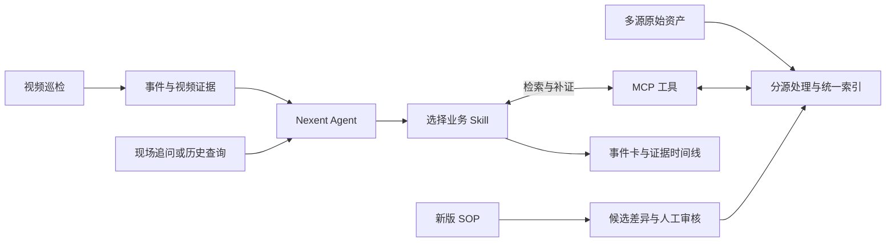

# 车间安全资产认知智能体项目实施方案

华为 ICT 大赛创新赛初赛  ·  实施基线 V1.0

## 赛题要求与方案对应表

| 编号 | 赛题任务 | 实施章节 | 现场验收与提交证据 |
|---|---|---|---|
| T1 | 面向制造业，统一识别、理解和标识文本、表格、图文等多模态资产 | §3 需求分析、§5 数据集选择与实施 | 导入 SOP、工单表、车间区域图、视频和语音，展示统一资产清单；从事件卡分别打开原视频区间、原表记录、原图位置和 SOP 条款。 |
| T2 | 低资源半自动构建本体，支持持续更新和行业规范对齐 | §6 低资源本体构建与增量审核 | 提交种子本体、候选差异、原文出处、审核记录和两个已发布版本；展示新版触发变更、历史事件查旧版、规范映射审核。 |
| T3 | 深度集成 Nexent MCP 与 Skills，形成检索与推理协同执行流 | §6 Nexent 执行链与 MCP 调用、§4 操作流程 | 导出实际配置和调用日志；演示规则要求许可后触发补查，并保留查不到、冲突或服务失败时的分支证据。 |
| T4 | 激活存量资产，支持跨文档多跳推理、决策溯源及 Skill 快速迁移 | §4 操作流程、§5 资产融合、§6 Skill 模板、§8 评测 | 展示事件经设备关联历史事件和整改记录，并按时间核对规则；输出可回放证据链。更换车间配置，复跑同一模板并记录改动与耗时。 |
| T5 | 智能体在 Nexent 上可运行 | §6 平台运行配置、§7–8 三周实施与独立复跑、§9 交付 | 从 Nexent 实际运行主案例和边界案例，提交可恢复的 Agent JSON、MCP、Skill、知识库及复跑说明。 |

## 1 项目分析

车间录像、设备台账、作业工单和安全规程分散保存。发现异常后，安全员需要分别核对画面、设备状态、作业授权和历史整改。项目以安全事件为入口，把已有数据变成可检索、可关联、可复核的证据，并在 Nexent 上完成巡检、现场音视频研判和历史溯源。

初赛拟选一个车间、一类主事件和一条完整业务链。优先从通道越界、设备面板状态中选择画面易判读且有正反例的事件。实际题材由第一周样例验证确定。用一段当前视频和一段历史视频配合模拟台账、工单、SOP 及整改记录，展示从发现到复盘的过程。

### 业务痛点与初赛边界

| 现有问题 | 初赛解决方式 | 可观察的业务价值 |
|---|---|---|
| 告警只有画面，安全员还要自行翻查作业授权 | 将候选事件关联到区域、设备、工单和适用规则 | 同一张事件卡给出观察、依据及待补证据 |
| 现场问答缺少明确指向，语音与画面脱节 | 对齐会话、语音时间、关键帧和当前事件 | 安全员能指向现场继续问，画面不清时系统会请求补拍 |
| 历史录像和整改记录分开保存 | 通过设备及事件 ID 连接视频、工单、规则和整改 | 能回放指定区间，说明历史问题怎样整改 |
| SOP 更新后，历史事件容易被套用当前规定 | 版本化维护本体、规则及适用范围 | 同类事件按事发时间分别命中旧版与新版 |

初赛以一个车间和一个主事件验证全链路。先选通道越界或设备区域进入，配备正常动作、疑似异常、证据不足及新旧规则案例。正式评测按真实取得的数据报告。公开视频验证画面理解，自采素材验证实际中文交互，模拟档案验证跨文档关联。系统提供辅助研判，由安全员复核和决定处置。

## 2 技术迁移与新增工作

### 实时事件检测

沿用原技术资料中的“目标检测 → 语义筛选 → VLM 时序核验”。增加区域定义、候选事件时间段、设备或工单查询及缺证状态。工业采样率和阈值通过样例确定。

### 现场音视频交互

沿用流式 ASR、视觉窗口与语音输出。将语音、现场帧与当前事件关联。语音转写、取帧和记录查询可并行执行，Nexent 负责业务决策与补证。

### 历史视频资产

沿用文本、视觉与图谱检索思路，用时序选帧保留事件前后过程。新增视频时间定位、跨文档关系与按历史版本核验规则。现有家庭场景结果作为迁移参考，制造场景另行评测。

## 3 需求分析

### FR-01 车间安全合规巡检

输入为视频流或按时间顺序回放的视频及摄像头、区域配置。系统检测候选事件，核验关键帧及时间范围，再查设备状态、授权记录和适用规则。事件卡包含事件 ID、设备或区域、可见事实、研判状态、缺失证据及回放入口。

验收  对异常、相似安全动作和遮挡样例各跑一次。异常可定位原片段，相似动作有排除依据，遮挡时能说明无法确认的事实。

### FR-02 现场音视频交互研判

安全员通过摄像头与麦克风提出问题。系统关联转写、提问时刻画面与当前事件，按需查询业务记录。对“这台设备”等指代，先确认设备身份再查询。音频不清或画面不可判读时，请求复述或补拍。

验收  用实际音视频完成两轮问答，第二轮沿用同一事件，并展示一次缺证提示及补证后的判断变化。

### FR-03 历史视频资产溯源

用户按设备、区域、时间和事件类型查询。系统检索视频候选，核验片段是否支持问题，并通过图谱关联历史事件、整改记录和事件发生时适用的规则。输出按时间排序的事件摘要和逐条可回放证据。

验收  回答一次“此前是否发生过类似情况，如何整改”，同时提供视频起止时间、历史事件与整改记录定位。相似片段与已确认关联分别标记。

### FR-04 本体增量更新

新版 SOP 或人工纠错触发变更候选。系统抽取术语、关系及规则差异，检查来源、冲突和影响范围，提交审核。审核后发布新版本，保留旧版及生效时间。

验收  用两版模拟 SOP 展示变更来源、审核结果和发布记录。对同一历史事件按事发时间检索，能命中当时适用条款。

### 补充功能及运行需求

| 需求 | 输入与约束 | 输出与验收 |
|---|---|---|
| FR-05 多模态资产登记 | 原视频、音轨、SOP、工作簿及区域图；保留原件、版本、模态和出处 | 同一检索结果能定位到原视频时间区间、表格行、SOP 条款和图文区域；缺失模态有标记 |
| FR-06 检索与推理协同 | Agent 获得事实后按规则确定缺项；限定补证次数和工具超时 | 至少演示一次因条款要求而追加许可查询，以及一次达到边界后返回待核验项 |
| FR-07 可复用工作流 | 流程、行业配置、适配器分离；工具契约统一 | 替换区域、数据源和规则后复跑；记录修改范围与耗时 |
| NFR-01 响应与资源 | 单路视频、低并发作为初赛基线；历史索引离线构建 | 记录巡检提示时延、交互首音与完整时延、峰值显存和测试环境 |
| NFR-02 可追溯与异常处理 | 每次执行记录事件、规则版本和调用结果 | 能复核证据；区分未找到、服务失败、来源冲突。没有查到许可时显示待核验 |
| NFR-03 可部署与可复跑 | Agent、工具、知识库、模型和数据版本配套记录 | 另一名成员按 README 恢复环境并跑通固定用例 |

## 4 主案例验收脚本

当前视频出现疑似越界，巡检 Skill 生成事件卡。安全员指向现场问“为什么报警”，系统定位区域，核对该时段的设备与授权记录。缺失授权时明确提示缺证。随后追问“以前怎样整改”，系统经设备关联历史事件和整改记录，返回两段可定位视频及适用条款。

另导入新版模拟 SOP，审核并发布一条变更。用相同历史事件回放验证旧版本可追溯。系统输出供安全员复核，现场处置由责任人员决定。

### 整个系统操作流程

| 阶段 | 操作者和输入 | 系统处理 | 可核验输出 |
|---|---|---|---|
| 1 资产入库 | 数据负责人导入原视频清单、SOP、工单、区域图 | 分源解析、抽帧和转写，建立统一索引和图谱关系 | 资产清单及原件定位 |
| 2 巡检发现 | 摄像头或按时间顺序回放的视频 | 轻量检测和语义筛选，VLM 核验候选，登记事件 ID | 事件卡、画面观察和视频回放 |
| 3 规则研判 | Nexent 巡检 Skill 收到事件 ID | MCP 查当时适用的规则、工单和许可；结果触发补查 | 研判状态、规则版本、缺证项和引用 |
| 4 现场追问 | 安全员用麦克风、摄像头追问 | 对齐语音与帧，确认对象。需要时提示补拍或补查 | 双轮问答、补证前后的结果 |
| 5 历史溯源 | 用户询问类似事件及整改 | 文本、视频、图谱召回；核验片段及关联记录 | 可回放时间线及整改证据 |
| 6 知识更新 | 维护人员上传新版 SOP 或提交纠错 | 差异抽取、影响校验、人工审核、发布 | 版本差异及旧事件复查结果 |

## 5 数据集选择与实施

### 选型对照与接入顺序

| 来源 | 优先级 | 对应任务 | 初赛选样与验收 |
|---|---|---|---|
| [Safe and Unsafe Behaviours](https://pmc.ncbi.nlm.nih.gov/articles/PMC11367630/) | P0 | 安全巡检、同类事件召回 | 优先核验通道越界／正常通行，面板开启／关闭作为备选。首批选清晰正例、相似反例和人工标记的缺证样例，验证原片能解码、取帧和定位。 |
| 受控自采音视频 | P0 | 中文现场交互 | 录制同一事件的画面指代、两轮语音追问和一次补证。单独记录采集场次、语音与画面时间和预期回答。 |
| 独立模拟车间档案 | P0 | 跨文档推理、整改追溯、本体更新 | 准备当前与历史事件、设备台账、工单、整改记录和两版 SOP。用统一设备及事件 ID 检验多跳关系和规则版本，明确标注模拟关联。 |
| [IndEgo](https://indego-dataset.github.io/) | P1 | 第一视角操作过程理解、历史片段定位 | 只选与检修或装配相关的少量连续录像，标注步骤及证据区间，用于检查选帧能否覆盖事件前后过程。 |
| [iSafetyBench](https://github.com/iSafetyBench/data) | P1 | 危险动作理解与视频问答 | 优先取可访问、与主事件相近的题目和视频做独立评测。按原始样本 ID 保存问答，不把短片问答成绩用作长视频检索指标。 |
| [InspecSafe-V1](https://huggingface.co/datasets/Tetrabot2026/InspecSafe-V1) | P2 | 工业巡检多模态与缺失模态验证 | 核对实际文件与模态后选子集。优先检查系统能否识别缺失模态并明确要求补证。 |

**第 2 天首批接入。**完成 P0 样例和资产引用联调。历史案例可先引用同源公开视频并关联独立的模拟整改记录。若首选公开视频暂未取得，先用受控录制的当前与历史片段跑通主链。第 2 周再按可获取性和任务缺口接入 P1、P2 子集。

每个实际采用的来源登记来源链接、版本、原样本 ID、任务、可用模态、原始划分、派生处理、证据区间及许可和分发核验结果。各数据源独立保存，MCP 通过统一索引按来源取证。正式提交时标出实际采用、仅候选和未接入的来源。

### 第一优先  Safe and Unsafe Behaviours

原始论文介绍了工厂固定监控的 691 个剪辑，覆盖四类安全行为和四类对应的不安全行为。优先选通道和面板状态的正反例，支撑巡检与历史相似片段召回。公开剪辑用于事件验证，长时间连续检索另用可获得的连续录像或明确标注的回放序列。[1]

### 第二优先  iSafetyBench 与 IndEgo

iSafetyBench 用于危险行为理解与视频问答，按作者提供的数据入口核对可访问视频及提交时的分发条件。IndEgo 选检修或装配小子集，用于第一视角步骤理解、关键帧及过程检索。中文现场对话、打断和补证用受控录制验证。[2][3]

### 条件接入  InspecSafe-V1

用于工业多模态研判和缺失模态验证，先检查样本实际提供的模态、体积及场景相关性，再选子集。[4]

### 数据保持独立

各来源分别保存原媒体和标注，通过适配器生成统一索引。视频以来源 ID、原样本 ID 和起止时间引用，文档以资产 ID、版本和条款定位，表格以工作表及记录 ID 定位。图文 OCR 记录页码和区域。保留裁剪偏移和处理版本。

模拟台账、工单和整改资料单独管理。引用公开视频时标注模拟关联，区分原片可见事实与虚拟工厂记录。评测按原视频或采集场次分组，避免切片跨开发集与评测集。公开视频、受控录制及模拟业务案例分别统计。

第 2 天交首批联调样例，后续按任务缺口增量处理。第 8 天锁定评测样例，第 11 天冻结提交清单。来源暂不可用时，以已取得的片段或受控录制维持联调，并保留选型记录。

### 原始数据说明

项目按来源独立保存媒体、原始标注和业务资料。以下为计划使用的数据范围，提交时按实际纳入的样本更新清单及数量。

| 来源 | 原始内容 | 项目用途 |
|---|---|---|
| Safe and Unsafe Behaviours [1] | 工厂固定监控剪辑及安全／不安全行为标签 | 优先选通道通行或面板状态正反例，验证巡检与相似事件召回。 |
| iSafetyBench [2] | 工业安全短视频及视频问答标注 | 验证危险行为理解，保留原问题及参考答案。 |
| IndEgo [3] | 第一、第三视角工业操作录像及样本提供的音频、动作等标注 | 选检修或装配子集，验证操作步骤和历史片段定位。 |
| InspecSafe-V1 [4] | 工业巡检样本及实际随样本提供的模态和安全评估标注 | 可选，用于多模态研判与缺失模态测试。 |
| 受控自采 | 中文语音、现场画面、采集场次及人工标注的提问和补证时间 | 验证语音追问、画面指代及补拍。 |
| 模拟车间档案 | 设备台账、区域图、工单、整改记录、两版模拟 SOP | 验证跨文档关联、条款引用和规则版本更新。档案与公开视频的关联标记为模拟。 |

原始数据清单记录来源、版本、原样本 ID、文件路径、格式、时长或记录数、实际模态、原始划分、许可核验结果及用途。样本未取得时标记为候选。业务档案记录生成方式和版本，保留原文、原表或原图。

### 数据处理说明

1. **登记与验收。**按来源登记原件，检查文件可读性、时间戳、标注对应关系和可用模态。保留原始数据及标注；无法解码、标签冲突或缺失音轨的样本分别标记。
2. **视频与音频。**按原片时间抽帧或切分片段，记录原片起止时间和派生片段偏移。对可用音轨做带时间戳的 ASR，将转写与关键帧对齐。视频理解生成可见事实和候选事件；遮挡、音频缺失等作为证据状态保存。
3. **文档、表格与图文。**SOP 按版本和条款切分。台账、工单和整改表按行提取结构化字段，保留工作表和记录 ID。扫描件、区域图等通过 OCR 或人工核验提取文字及位置，保留页码或图像区域。
4. **标识与索引。**为视频、文档和表格分配资产 ID，为事件和设备分别分配事件 ID、设备 ID。视频证据引用原样本及时间区间，SOP 引用版本和条款，表格引用记录 ID。构建文本／视觉检索索引与图谱关系，保留从派生结果反查原件的路径。
5. **对齐与审核。**优先用设备编号和事件 ID 关联记录。术语别名和新概念进入候选审核。公开视频标签与车间本体之间保留映射，画面观察、模拟记录、规则判断分别存储。工单、许可等关键记录缺失时输出待核验。
6. **划分与输出。**遵循可用的原始划分，同一原视频或采集场次的片段不得跨开发与评测集合。分别记录公开视频感知评测、自采交互评测和模拟业务推理评测。交付来源清单、处理配置、派生索引、图谱与规则版本及评测样本清单。

### 数据集的逻辑合并与资产标识

合并发生在**统一索引、标签映射和案例关联**三个层面。各数据集保持独立目录与原始划分，适配器把不同来源的元数据映射到统一结构。公开短片与模拟工单的关联标为模拟，只有同一原片或可核验的连续录制才用于验证真实时间顺序。

| 层 | 实施方法 | 样例 |
|---|---|---|
| 来源层 | 每个来源登记版本、许可、文件校验值、可用模态和原样本 ID | SAFE 来源下的原样本 023 |
| 资产层 | 同一资产保留稳定 ID，内容变更记录版本，派生片段记录原片偏移 | 视频 VID-SAFE-023，SOP-MAINT v2，工单表 TABLE-WORKORDERS |
| 证据层 | 保存资产 ID、版本和具体位置；视频用时间区间，图文用页码或区域，表格用记录 ID | VID-SAFE-023 的 12–18 秒；SOP-MAINT v2 第 3.2 条 |
| 语义层 | 保存来源标签、统一标签、映射依据与审核状态；无法可靠映射的标签保留待核验 | 通道类标签映射至候选越界事件 |
| 案例层 | 使用事件、设备和区域 ID 关联资产证据，记录关系来自真实记录还是模拟配置 | EVT-003 涉及 M-07，引用视频并关联模拟工单 WO-101 |

**资产 ID 表示资料，事件 ID 表示发生的事，设备 ID 表示业务对象。**一个事件可以引用多份资料，一份视频也能支持多个事件。第 2 天只交联调子集，后续按任务缺口处理。第 8 天锁定评测样例，第 11 天冻结提交清单。发布前检查重复样本、时间偏移、缺失模态与开发评测重叠。

## 6 系统设计与知识更新

### Nexent 执行链

输入由监控事件、现场会话或历史查询触发。总控 Agent 选择业务 Skill，调用 MCP 获取证据，整理已确认事实、冲突项及缺项。缺项决定下一次工具调用，达到预算或工具失败时返回已有证据、缺项及人工复核提示。

巡检 Skill 调用事件确认、设备记录与条款查询。现场研判 Skill 关联语音、现场帧与事件 ID，并按需补证。历史溯源 Skill 并行查文本、视频和图谱，再验证候选证据与结论的对应关系。各 Skill 通过设备、区域、规则参数复用。

MCP 服务提供 search_assets、get_video_evidence、get_record、query_graph 和 compare_rule_versions 等拟定工具。工具返回结构化事实、证据定位与状态。连接方式、实际名称、超时及导出格式以参赛实例联调为准。记录模型及版本、提示词、工具 Schema、知识库分块与检索配置、路由和终止条件。[5]

### MCP 调用与平台运行配置

Nexent 通过 MCP 客户端发现工具并调用服务。服务端封装视频索引、工单库、版本规则和图谱；Skill 定义业务顺序、补证分支和输出，Agent 根据返回证据决定下一步。按参赛实例支持的远程 MCP 或 API 转 MCP 方式接入，逐工具测试后绑定 Agent。接口名为设计约定，最终提交以平台日志及实际 Schema 为准。[Nexent MCP 集成文档](https://modelengine-group.github.io/nexent/en/integration/integration-in/mcp.html)

| 工具 | 关键参数 | 返回证据或行为 |
|---|---|---|
| get_event_evidence | event_id | 事发时间、区域、设备、画面事实和原片位置 |
| lookup_applicable_rule | event_type、area_id、occurred_at | 已发布且当时适用的规则、条款和必需证据 |
| get_work_order、get_permit | 设备或工单 ID、区域、事发时间 | 工单、许可、覆盖范围及状态 |
| get_session_observation | session_id | 对齐后的转写、关键帧及当前事件 |
| search_video_assets、query_event_graph | 对象、类型、时间范围 | 候选片段及事件到整改的关联路径 |
| compare_sop_versions、list_change_candidates | 文档 ID、版本、变更 ID | 条款差异、候选、出处和审核状态 |

首次运行先绑定视频取证、规则和工单三类工具。取证后按事发时间查规则；若规则要求作业许可，则继续补查许可。未找到时保留已经取得的依据和待核验项，服务异常按限定次数重试或提示复核。规则版本判定、审核状态和发布权限由后端校验。连续音视频流由感知模块处理，MCP 按需返回转写、关键帧或回放引用。

部署记录包含实际模型与参数、提示词、知识库分块及召回、Skill 绑定、MCP 地址与 Schema、超时及终止条件。初赛优先使用可用模型服务、单路抽帧和离线历史索引。本地 16–24 GB 显存单卡可作为低并发试跑预算，实际容量以峰值显存和输入规模测量为准。

### 可复用 Skill 模板设计

将每个 Skill 拆成**固定业务流程、行业配置包和 MCP 适配器**。固定流程决定在哪个环节检索、怎样补证、何时停止以及输出哪些引用。行业配置包定义要查什么、怎样核验和谁负责复核。适配器负责把目标系统的原始字段转换为工具契约。跨场景时保留流程及契约，按差异替换配置或适配器。

| 业务模板 | 通用模块 | 按行业或场景修改 |
|---|---|---|
| 巡检 | 接收候选事件 → 查询关联记录 → 读取事发时适用规则 → 核对证据 → 输出事件卡 | 风险类别、区域或对象、感知模型与阈值、规则来源、必需证据和升级条件 |
| 现场研判 | 绑定会话观察 → 解析指代 → 查记录 → 提示补证 → 汇总研判 | 业务术语和别名、可采集模态、需要补问的字段、角色权限及复核提示 |
| 历史溯源 | 拆解查询 → 并行检索 → 多跳关联 → 核验证据 → 输出时间线 | 数据源、索引字段、实体关系映射、检索范围和可见记录 |
| 本体更新 | 比对版本 → 提取候选 → 校验出处和冲突 → 送审 → 发布并留存旧版 | 初始概念与关系、条款切分方式、标准映射、审核角色与发布规则 |

#### 工具契约与替换边界

- 输入统一包含任务类型、对象或事件 ID、时间范围和可选会话 ID。适配器负责处理业务字段，例如把台账设备号或目标行业对象编号转换为统一对象 ID。
- 取证结果统一包含事实、来源资产 ID、位置或时间区间、版本和状态。区分“有证据”“未找到”“来源冲突”“工具失败”，供固定流程选择补证或退出。业务规则和证据要求由行业配置提供。
- 新场景若能沿用工具契约，只需配置数据源、术语、规则和字段映射。后端接口或模态变化时替换对应适配器。新增审批节点或必需的决策步骤时，再扩展固定流程并单独验收。

#### 模板交付结构

| 文件或目录 | 内容 |
|---|---|
| 各业务包根目录的 `SKILL.md` | 激活条件、执行顺序、工具调用规则、缺证分支和输出格式 |
| `contracts/` | 工具输入输出 Schema、状态和证据引用约定 |
| `profiles/` | 场景配置示例，包含概念映射、数据源、必需证据、SOP、复核角色及权限要求 |
| `adapters/` | 外部业务系统到工具契约的字段转换及 MCP 接入说明，按部署需要独立启动 |
| `examples/` 与 `README.md` | 最小输入输出、回归样例、配置及部署步骤 |

以上为项目交付目录约定。Skill 包按参赛实例支持的格式导入 Nexent，配置和 MCP 服务按 README 部署。参赛环境的具体挂载方式以联调为准。

#### 轻量化迁移步骤与验收

1. **做场景差异表。**确认目标场景的事件、对象、数据源、适用条款、审核角色和允许使用的证据。逐项标出复用、改配置或换适配器。
2. **复制配置并建立映射。**保留原 Skill 流程，替换事件字典、对象及区域映射、适用规则与证据要求。用一组最小业务记录检查映射能反查到原件。
3. **接入工具与知识。**注册或替换目标 MCP 服务，导入目标知识库和本体映射，核对输入输出和权限。先单测取证，再在 Nexent 中绑定 Skill 和工具复跑。
4. **按同一套验收用例复跑。**覆盖证据充分、证据不足、规则版本变化和工具失败。核对结论、条款版本和引用定位，记录迁移耗时、修改文件及是否改动通用流程。

初赛选一条巡检 Skill 做迁移验证。例如从车间 A 的通道越界切到车间 B 的通道越界，替换区域、摄像头、SOP 和数据映射，用第二组案例验证流程可复用。跨行业迁移用对象、数据和规则差异表说明适配范围，实际效果以完成的复跑为准。

### 低资源本体构建

用少量专家种子建立设备、区域、作业、风险事件、条款、工单、整改与证据概念。抽取候选关系并对齐术语，候选必须附来源定位。根据证据完整度、冲突及影响范围安排人工审核。批准后发布版本并保存旧版本和生效区间。

规则保存适用对象、触发条件、例外及来源。企业 SOP 与行业规范的映射经审核确认。以“事件 → 设备 → 历史事件 → 整改记录”为多跳样例，以“事件时间 → 适用版本 → 条款”为合规核验路径。

### 本体增量更新与行业规范映射审核

**专家种子**是人工确认的初始概念、关系及抽取示例。先用设备、区域、作业、工单、风险事件、条款和证据覆盖主案例。比如工单 WO-101 对应设备 M-07，关系证据指向工单记录行。新增工单是实例变化，新增“作业许可”及“许可覆盖区域”是本体变化，新增核验条件是规则变化。

| 步骤 | 自动化部分 | 人工判断与留痕 |
|---|---|---|
| 差异检测 | 对比 SOP 条款，识别新增、修改和撤销，只抽取变化部分 | 确认条款改动是否影响业务 |
| 候选抽取 | LLM 从变化条款抽取候选概念、实体、关系和规则，附版本、出处与新增理由 | 判断复用、扩展还是新增 |
| 校验和排序 | 校验出处、关系类型、重复项、范围及生效期冲突；影响研判的变更优先 | 核对业务语义、例外和影响范围 |
| 标准对齐 | 提议“本体项 → 企业 SOP 条款 → 正式行业规范条款”映射 | 比对原文及版本，记录适用范围、理由及接受、修改或拒绝结果 |
| 发布与回归 | 生成差异、保留旧版，回归验证已有案例 | 确认生效时间，批准发布；审核结果回填术语表和抽取示例 |

用团队编写并标明模拟的两版 SOP 演示。v1 核验检修工单，v2 对指定区域新增作业许可及覆盖范围的检查。上传 v2 后，展示自动生成的本体、关系和规则候选，审核后发布。分别用旧事件和新事件验证旧条款命中及新许可补查。历史查询按事发时间和适用范围选择已发布版本，遇到冲突转人工确认。行业规范使用正式来源，模拟 SOP 与实际规范的映射单独审核。

### 验证与可追溯性

每次运行保留事件 ID、工具调用、规则版本和证据引用。业务结论区分可见事实、记录事实、推断和待确认事项。对照直接抽取基线，评估证据校验与冲突筛查对接受率、修订量和审核耗时的影响。

## 7 三人分工与开工安排

### 章烈涵  Nexent 与集成

负责参赛实例、总控 Agent、MCP 注册、Skill 编排和异常分支。汇总实际配置、运行日志、调用图和提交包。

### 万晶宇  音视频与交互

负责检测迁移、取帧与时间定位、实时音视频和回放接口。提交音视频代码、运行截图和评测数据。

### 毛润佳  数据与知识图谱

负责来源清单、模拟业务档案、资产索引、本体更新及对比实验。提交知识库、图谱版本及数据处理说明。

### 第 1 周  打通最小链路

第 1 天，A 验证模型、MCP、Skill 和导出入口。B 试解码候选视频并试跑原模块。C 核对可用样本、分发条件和业务关系。共同定主事件。

第 2 天，锁定证据字段。B 交正例、相似反例和缺证样例。C 交模拟 SOP、工单及来源清单。A 用占位返回值调通编排。

第 3 天，B 输出候选事件和时间段，C 接通最小图谱和知识库，A 替换占位工具。给定事件 ID 可查原片和记录。

第 4 天，联调规则核验、语音转写与现场取帧，测试安全反例和缺证分支。

第 5 天，在 Nexent 上运行实际取证链，保留结果、日志与首份配置。三人同步编写负责章节。

### 第 2 周  完成业务闭环

第 6 天接通实际音视频追问。第 7 天完成历史片段与整改记录的关联检索。第 8 天串起三项任务并锁定评测样例。第 9 天完成 SOP 差异抽取、审核与版本发布。第 10 天复跑主案例、缺证与工具失败分支，并展示一次本体更新。

## 8 第三周评测与提交

第 11 天冻结功能、接口及提交数据清单。第 12 天汇总事件召回、误报、交互首音和完整研判时延、视频定位、多跳引用与本体审核结果。各指标记录样本量、环境和测量口径。

第 13 天由 B 或 C 根据 README 独立导入配置、启动 MCP、挂载或重建知识库并复跑。第 14 天合并 Word 和附件，核对截图、配置和数据版本。第 15 天修复复跑问题并形成最终提交包。

### 四项评分证据

- 编排集成  交付实际调用图、成功与失败日志，解释检索结果如何触发下一步补证。

- 业务价值  对同一问题比较人工与系统查找耗时，并核对视频、适用条款、工单和整改是否齐全。

- 算法创新  同批文档、同一审核准则，对比直接抽取和证据约束流程，展示审核效率和错误变化。

- 交互与复用  保存真实音视频问答与回放截图，更换一组设备或区域配置后复跑一个 Skill。

### 15 个工作日交接与验收清单

| 日 | A · Nexent | B · 音视频 | C · 数据图谱 | 当日验收 |
|---|---|---|---|---|
| 1 | 验证模型、工具、Skill 和导出 | 试解码与原模块复跑 | 核对来源、模态和可用范围 | 锁定主事件与证据需求 |
| 2 | 用样例返回值调通编排 | 交正例、反例、缺证片段 | 交模拟 SOP、工单、字段映射 | 冻结联调契约 |
| 3 | 绑定实际取证工具 | 输出事件 ID 与原片区间 | 接通图谱、知识库、规则查询 | 同一事件能查视频与记录 |
| 4 | 调试缺证分支 | 联调语音和取帧 | 校验 ID、条款与生效时间 | 能说明缺什么证据 |
| 5 | 在 Nexent 复跑并留日志 | 验证视频回放 | 验证条款和表格回链 | 真实取证链通过 |
| 6 | 接现场研判 Skill | 跑中文音视频双轮 | 补对象别名和条款条件 | 语音、画面、事件对齐 |
| 7 | 接历史溯源 Skill | 交片段检索与回放 | 接整改图谱路径 | 返回历史片段与整改 |
| 8 | 联调三任务路由 | 补噪声、遮挡等样例 | 锁定独立评测清单 | 完成一次连续会话 |
| 9 | 接入更新流程 | 准备新旧事件视频 | 抽取差异、审核及发布 | 新旧版本分别命中 |
| 10 | 跑主流程及异常日志 | 核验补证体验 | 核对证据及映射审核 | 三任务与一次更新通过 |
| 11 | 冻结配置 | 冻结音视频子集 | 冻结数据清单 | 固定正式评测环境 |
| 12 | 汇总补证与工具记录 | 测召回、误报、时延与定位 | 测抽取质量和审核耗时 | 留原始评测记录 |
| 13 | 导出 Agent 与依赖 | 按 README 独立复跑 | 核验知识库重建及版本 | 复跑者能还原结果 |
| 14 | 汇总 Word 和附件 | 录制演示、提供真实截图 | 核对来源与规则引用 | 文档与运行版本一致 |
| 15 | 核对最终包 | 修复回放问题 | 核对数据及知识库材料 | 交付物齐全且可复跑 |

团队仓库记录工具契约、样例返回值和联调版本。每天以固定事件 ID 检查交接，收工前对齐已交付、已被谁调用、当前阻塞。未拿到的公开子集由可用样例临时支撑，保留来源差异和后续补测事项。

## 9 最终交付

### 开发设计 Word

按官方初赛模板填写项目概述、整体设计、原始数据与处理、图谱构建和智能体方案。写明实际模型、工具、知识库、Agent 调用关系、调试迭代和真实问答截图。本文可作为撰写底稿。

### 可复跑附件

提交实际导出的 Agent JSON、MCP 与完整项目代码、Skill 模板、可分发知识库和重建说明、图谱与规则版本、各数据源的子集及处理清单、复跑 README。演示视频和评测记录用于补充验证。提交包按赛方要求命名并打包。

### 最终包核对表

| 文件或附件 | 主责 | 验收 |
|---|---|---|
| 官方模板开发设计 Word | A 汇总，B、C 分写 | 包含项目、需求、系统、数据、图谱、Nexent 实际配置、调用图、调试迭代和真实问答截图 |
| 实际 Agent JSON | A | 可导入或按 README 恢复；模型、MCP、Skill、知识库依赖齐全，凭证使用占位 |
| 完整代码及 MCP 服务 | A、B、C | 启动说明、依赖、接口 Schema、错误状态及工具样例齐全 |
| Skill 模板和迁移材料 | A、B | 交流程、配置与适配器，附第二车间复跑记录 |
| 知识库和数据材料 | C | 可分发资料或获取说明、来源清单、处理脚本、索引、本体、规则及审核记录 |
| 演示和评测 | B 主录，A、C 补证 | 主案例、异常分支、历史版本、模板迁移的实际运行证据；实测结果注明样本量和环境 |

## 10 资料与待确认项

### 团队已有资料

《基于端边协同的家庭多模态推理与研究》用于梳理事件检测、实时通话和历史档案检索的迁移路径。《实时视频通话部署与优化方案》和《长序列理解挑战趋势与前沿》作为实施和选帧方法参考。正式开发设计文档沿用工作区的赛题 3 初赛模板。

### 公开来源

[1] Video dataset for the detection of safe and unsafe behaviours in workplaces

<https://pmc.ncbi.nlm.nih.gov/articles/PMC11367630/>

[2] iSafetyBench 原始论文及数据入口

<https://github.com/iSafetyBench/data>

[3] IndEgo 官方项目页

<https://indego-dataset.github.io/>

[4] InspecSafe-V1 作者发布数据卡

<https://huggingface.co/datasets/Tetrabot2026/InspecSafe-V1>

[5] Nexent 官方第三方集成文档

<https://modelengine-group.github.io/nexent/en/integration/>

### 开工确认

主事件、可用子集、来源分发条件及参赛实例能力在第一周确认。正式评测前冻结性能口径。配置、截图、日志和实测结果以最终复跑版本补齐。
